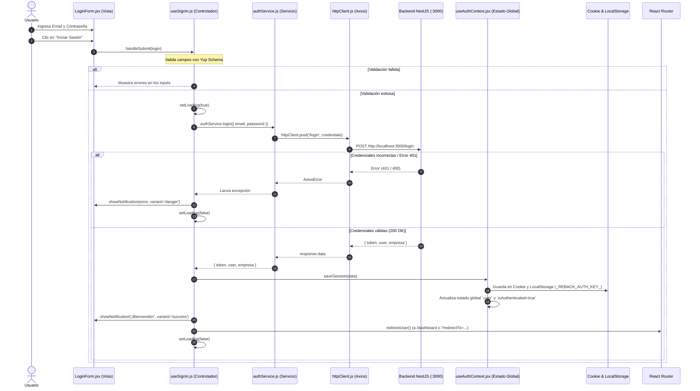

# Documentación del Flujo de Login en el Frontend

Esta documentación describe en detalle la arquitectura, componentes, ciclo de vida y mecanismos de seguridad implementados en el frontend para el proceso de autenticación e inicio de sesión con el backend.

---

## 1. Diagrama de Flujo y Secuencia



---

## 2. Capas y Responsabilidades (Patrón MVC + Servicios)

El frontend organiza la lógica de autenticación siguiendo una separación clara de responsabilidades:

| Capa | Archivo | Responsabilidad Principal |
| :--- | :--- | :--- |
| **Vista (View)** | [`LoginForm.jsx`](file:///c:/Users/Administrator/Desktop/crm-whatssap-practica/src/pages/sign-in/LoginForm.jsx) | Renderiza los campos de entrada, botones y estados visuales (carga/deshabilitado). |
| **Controlador (Controller)** | [`useSignIn.js`](file:///c:/Users/Administrator/Desktop/crm-whatssap-practica/src/pages/sign-in/useSignIn.js) | Gestiona el estado local del formulario, validación Yup, invocación de servicio, feedback al usuario y redirección. |
| **Servicio (Service)** | [`authService.js`](file:///c:/Users/Administrator/Desktop/crm-whatssap-practica/src/services/authService.js) | Abstracción de llamadas API al endpoint `/login` del backend. |
| **Cliente de Red (Client/HTTP)** | [`httpClient.js`](file:///c:/Users/Administrator/Desktop/crm-whatssap-practica/src/helpers/httpClient.js) | Instancia configurada de Axios, URL base, timeout e interceptores para adjuntar JWT automáticamente. |
| **Estado y Persistencia (Context)** | [`useAuthContext.jsx`](file:///c:/Users/Administrator/Desktop/crm-whatssap-practica/src/context/useAuthContext.jsx) | Mantiene el estado en memoria React y sincroniza la sesión en `cookies` y `localStorage`. |
| **Definición de Modelos** | [`auth.model.js`](file:///c:/Users/Administrator/Desktop/crm-whatssap-practica/src/models/auth.model.js) | Tipos y contratos de datos (usuario, empresa, sesión) y credenciales por defecto. |

---

## 3. Desglose Paso a Paso del Flujo

### Paso 1: Interacción en la Vista (`LoginForm.jsx`)
* El usuario visualiza los campos `<TextFormInput name="email" />` y `<PasswordFormInput name="password" />`.
* Los inputs están conectados al gestor de formularios `react-hook-form` mediante el objeto `control`.
* El botón de submit se bloquea automáticamente (`disabled={loading}`) y cambia su texto a `"Iniciando sesión..."` durante la petición.

### Paso 2: Validación de Datos (`useSignIn.js`)
Antes de emitir cualquier petición de red, los datos se validan en el cliente mediante **Yup**:
```javascript
const loginFormSchema = yup.object({
  email: yup.string().email('Ingresa un correo electrónico válido').required('Por favor ingresa tu correo'),
  password: yup.string().required('Por favor ingresa tu contraseña'),
});
```
* Si el correo tiene formato incorrecto o falta la contraseña, se interrumpe el flujo y se muestra el error debajo del campo correspondiente.

### Paso 3: Disparo de la Petición al Backend (`authService.js`)
* Se activa la bandera `loading = true`.
* `authService.login(values)` efectúa la llamada HTTP POST:
```javascript
async login(credentials) {
  const response = await httpClient.post('/login', credentials);
  return response.data;
}
```

### Paso 4: Configuración e Intercepción HTTP (`httpClient.js`)
* Se envía a la URL base configurada:
  ```javascript
  baseURL: import.meta.env.VITE_API_URL || 'http://localhost:3000'
  ```
* En peticiones posteriores, el interceptor de Axios extrae automáticamente el token guardado y lo añade al encabezado:
  ```javascript
  config.headers.Authorization = `Bearer ${session.token}`;
  ```

### Paso 5: Manejo de Respuesta Exitosa
Si el backend responde con código HTTP 200 y devuelve el token:
1. **Persistencia (`saveSession`)**:
   Guarda los datos bajo la clave `_REBACK_AUTH_KEY_`:
   - En una **Cookie** con `path: '/'` (permitiendo lectura en servidor si fuera necesario).
   - En **`localStorage`** como respaldo persistente en el navegador.
2. **Actualización de React Context**:
   Se actualiza la propiedad `user` y `isAuthenticated = true`.
3. **Notificación**:
   Se dispara un toast: `"¡Bienvenido de nuevo, [Nombre]! Redirigiendo..."`.
4. **Redirección inteligente**:
   Verifica si existía un parámetro en la URL `?redirectTo=/ruta`. Si existe, lo lleva a esa ruta; de lo contrario, redirige al `/dashboard`.

### Paso 6: Manejo de Excepciones y Errores
Si el backend responde con error (e.g., credenciales inválidas, 401 Unauthorized, servidor caído):
* Se captura en el bloque `catch (e)`.
* Extrae el mensaje específico devuelto por el backend (`e.response?.data?.message` o `e.response?.data?.error`).
* Muestra un toast de alerta tipo `danger`.
* En el bloque `finally`, se restablece `loading = false` para habilitar nuevamente el formulario.

---

## 4. Estructura de Datos (Payloads)

### Payload enviado al Backend:
```json
{
  "email": "usuario@novatech.co",
  "password": "miPasswordSeguro123"
}
```

### Payload esperado del Backend:
```json
{
  "token": "eyJhbGciOiJIUzI1NiIsInR5cCI6IkpXVCJ9...",
  "user": {
    "id": 1,
    "nombre": "Carlos",
    "apellido": "Gómez",
    "email": "usuario@novatech.co",
    "empresa_id": 1,
    "rol": "ADMIN"
  },
  "empresa": {
    "id": 1,
    "nombre": "NovaTech",
    "nit": "900123456-1"
  }
}
```

### Estructura almacenada en `_REBACK_AUTH_KEY_`:
El objeto completo recibido del backend se serializa como cadena JSON tanto en Cookie como en LocalStorage para garantizar que el estado de sesión persista incluso al recargar o abrir nuevas pestañas.
